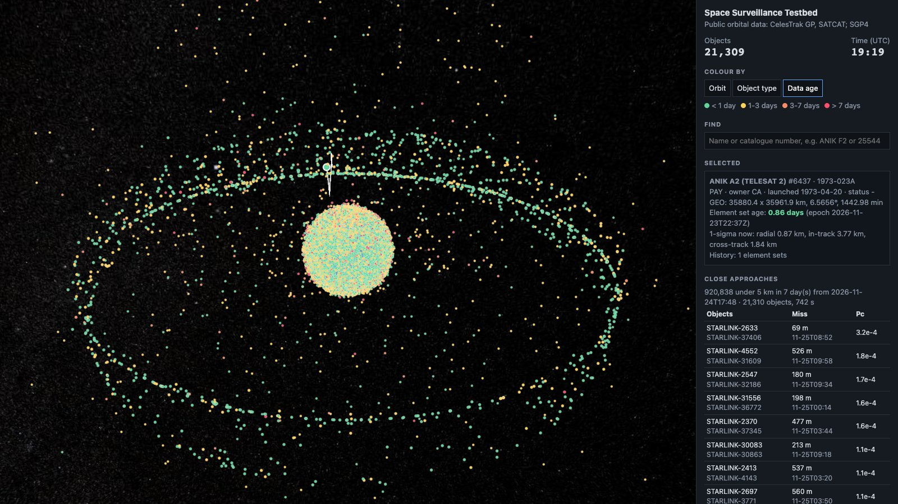
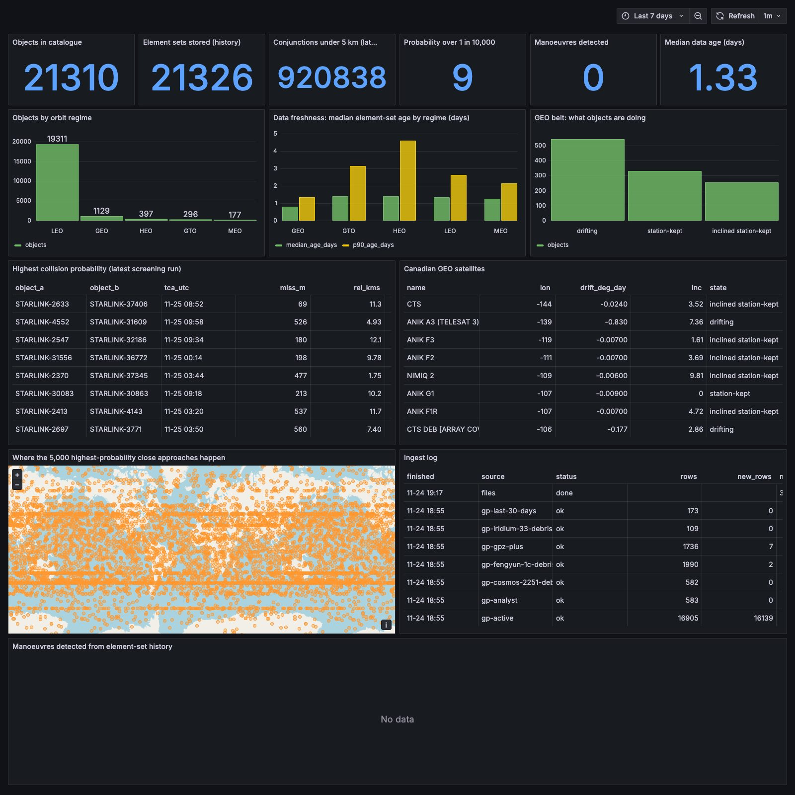

# Space Surveillance Testbed: tracking the catalogue from public data

A space situational awareness platform shaped by the public description of
National Defence's **Surveillance of Space 2 (SofS 2)** project: sensors and
processing to detect, track, characterise and monitor deep-space objects,
protect Canadian deep-space assets, and contribute to the Space Surveillance
Network. Everything here uses public data: CelesTrak's orbital elements and
satellite catalogue, operator-derived orbits, NASA's ISS ephemeris.

> Independent personal research by Taki Sadik. Not affiliated with, funded by,
> or submitted to DND, the CAF or any space agency. Orbital data from CelesTrak
> and NASA is fetched by the scripts, not redistributed here.
> Project page: https://tyfsadik.org/work/defence/surveillance-of-space



| Need | Here |
| --- | --- |
| Import public orbital data | CelesTrak GP for active satellites, the GEO protected zone, three debris clouds, recent launches and analyst objects (21,310 objects), SATCAT metadata, operator orbits; the ingest respects CelesTrak's two-hour update cycle and logs its refusals |
| Positions, orbits, metadata | vectorised SGP4, FastAPI, CesiumJS globe: owner, launch, type, size, orbit, element-set age, uncertainty now |
| History | every element set ever fetched, in PostgreSQL; manoeuvre detection between consecutive sets |
| Close approaches | active payloads against everything over 7 days; collision probability; validated against SOCRATES |
| Uncertainty and freshness | measured against operator orbits and NASA's ISS ephemeris, per orbit regime |
| Deep space (SofS 2) | GEO belt characterisation, the neighbours of every Canadian GEO satellite, an optical sensor pipeline |
| Grafana | catalogue health dashboard |

## Results (final rehearsal)

**Conjunction screening against CelesTrak SOCRATES, on the exact element sets it used**

| | Result |
| --- | --- |
| Same pairs (958 conjunctions) | time of closest approach within 0.8 ms, miss distance within 0.5 m (SOCRATES's rounding), relative speed within 0.5 m/s |
| Same hour screened independently | **917 of 917** SOCRATES conjunctions found; 5 more that SOCRATES did not list (cause not determined) |

**The full 7-day screen** (21,310 objects, 16,901 active payloads, 12 minutes on a laptop in Docker):
920,838 approaches under 5 km. By family, per hour, against SOCRATES:

| | Mine | SOCRATES |
| --- | --- | --- |
| Starlink vs other objects | 432 | 498 |
| Everything else | 146 | 260 (larger catalogue: 33,000 objects) |
| **Starlink vs Starlink** | **4,903** | **182** |

The Starlink-against-Starlink gap is unresolved: it is not the accuracy of the
public elements (operator orbits made it larger), and every pair SOCRATES does
list is matched exactly. See [docs/04-findings.md](docs/04-findings.md).

**How wrong is public orbital data?** Catalogue minus truth, median:

| Element-set age | LEO (Starlink, 145,769 samples) | MEO (GPS, laser-ranging targets) | GEO (Intelsat, SES, Telesat, EUMETSAT) |
| --- | --- | --- | --- |
| under 6 h | 1.0 km | 0.4 km | 2.0 km |
| 12 to 24 h | 5.5 km | 1.5 km | 4.2 km |
| 1 to 2 days | 13.6 km | 1.2 km | 6.8 km |
| 2 to 3 days | 41 km (41% of samples over 50 km: Starlink manoeuvres often) | 1.8 km | 4.7 km |

The ISS's public element set against NASA's own ephemeris: under 1 km for
three days, 2.9 km at five, 12.7 km at seven, 85 km at fourteen, almost all
along-track.

**Deep space:** 1,129 GEO objects: 332 station-kept, 254 inclined station-kept,
543 drifting. 20 Canadian objects in GEO (8 station-kept, 5 inclined, 7
drifting); Anik F1R and Anik G1 share 107.3 W, 37 km apart at closest.

**Optical sensor** (30 synthetic frames of the GEO belt from Toronto, with lens
distortion, seeing and catalogue error; satellites drawn at their operators'
orbits where published):

| | Result |
| --- | --- |
| Frames solved | 29 of 30 (one rejected by the quality gate) |
| Position error | 1.1 arcsec median, 2.6 arcsec 95th percentile (about 0.2 and 0.5 km at GEO range) |
| Satellites detected | 89 of 96; everything to magnitude 13; magnitude-15 debris not seen in 2 s |
| Identified correctly | 88, none wrong |
| Injected uncatalogued objects flagged | 28 of 30 |
| Injected manoeuvres flagged | 27 of 28, no false flags |
| False streaks, false alarms | 0, 0 |

**Platform:** positions of all 21,310 objects in 85 ms; object detail in 2 ms.



## Quick start

```bash
./local/fetch.sh            # public data into data/raw (slow and rate-limited: be patient)
./local/rehearse.sh up      # viewer http://127.0.0.1:8000, Grafana http://127.0.0.1:3000
./local/rehearse.sh test    # the full rehearsal, about 25 minutes
```

## Docs

1. [Physical setup](docs/01-physical.md): an optical sensor for the GEO belt
2. [Deploy](docs/02-deploy.md): live mode, data sources
3. [Before anything real](docs/03-production.md)
4. [What the rehearsal found](docs/04-findings.md)
- [Architecture reference](docs/architecture.md)

## Repository map

```
sos/        catalogue, SGP4, conjunction screening, uncertainty and probability, GEO belt, SOCRATES parser, store, jobs
sensor/     the optical pipeline: detection, plate solution, star subtraction, streaks, correlation
services/   ingest, API + CesiumJS viewer
stacks/     docker compose, Grafana provisioning and dashboard
tools/      calibration, SOCRATES validation, optical rehearsal, screenshots
local/      fetch and rehearsal scripts
tests/      unit tests
results/    rehearsal runs
```

MIT licence.
